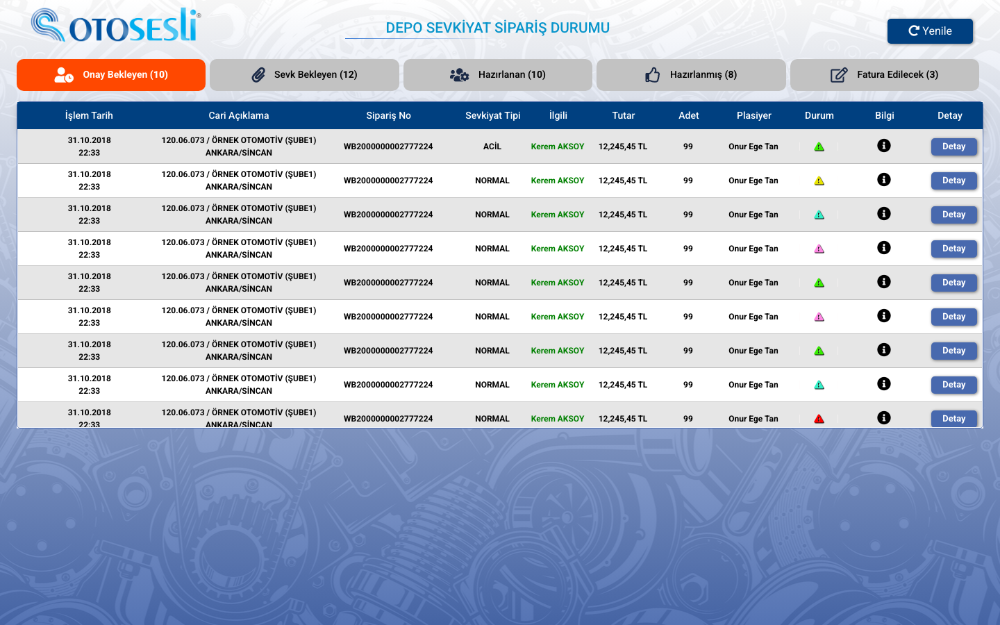
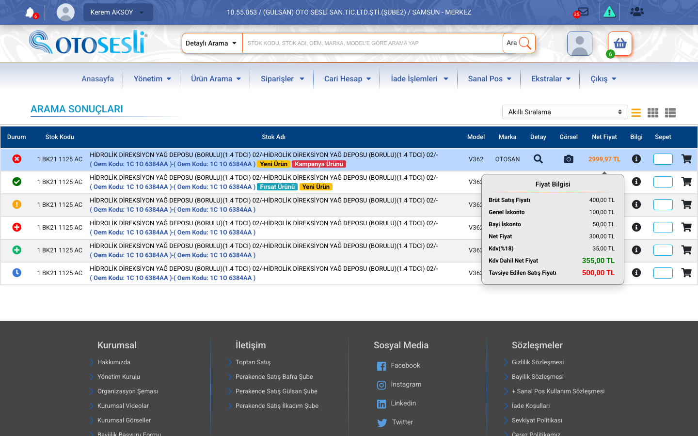
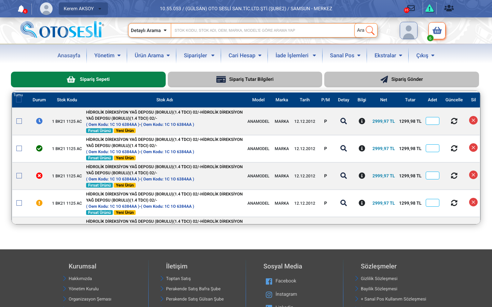
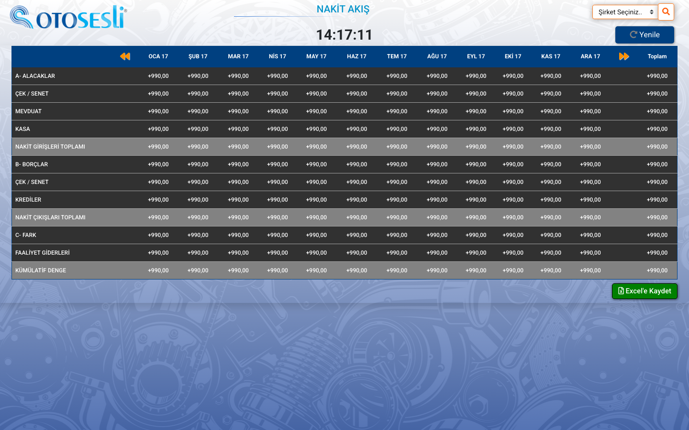
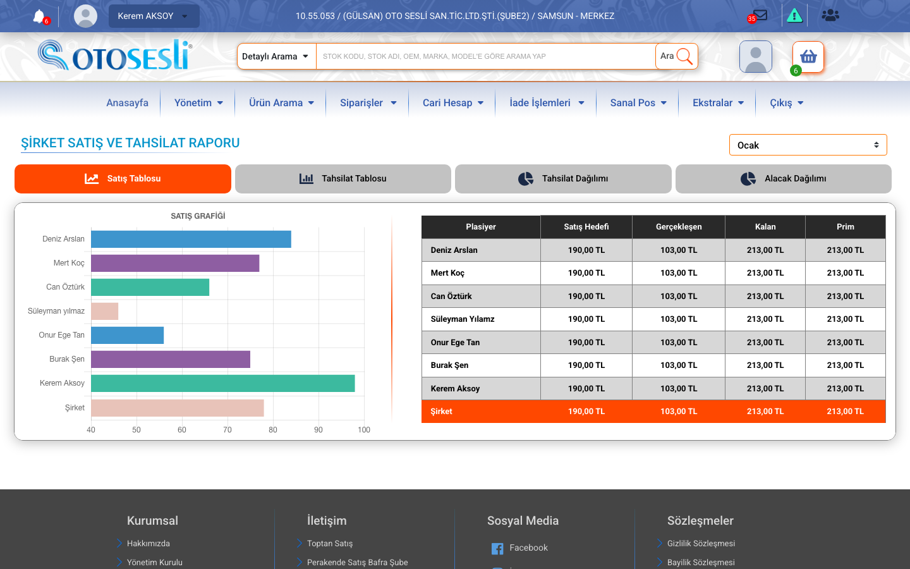
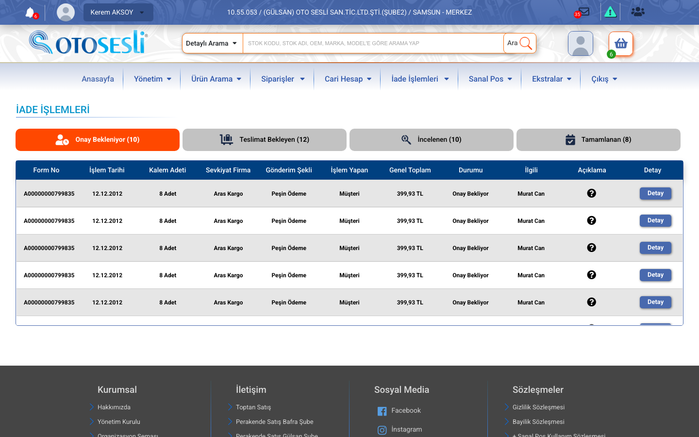
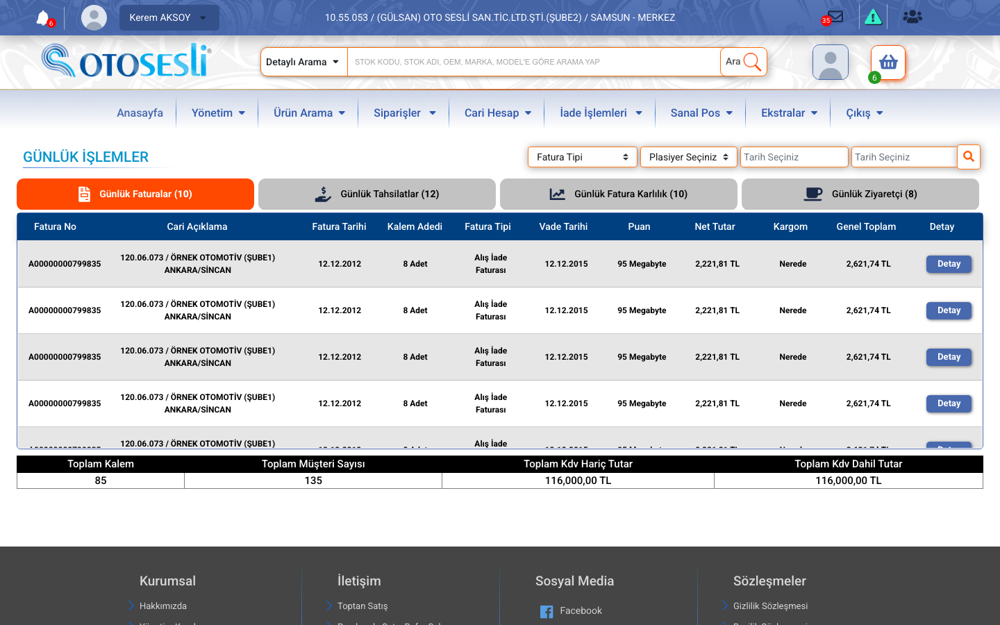
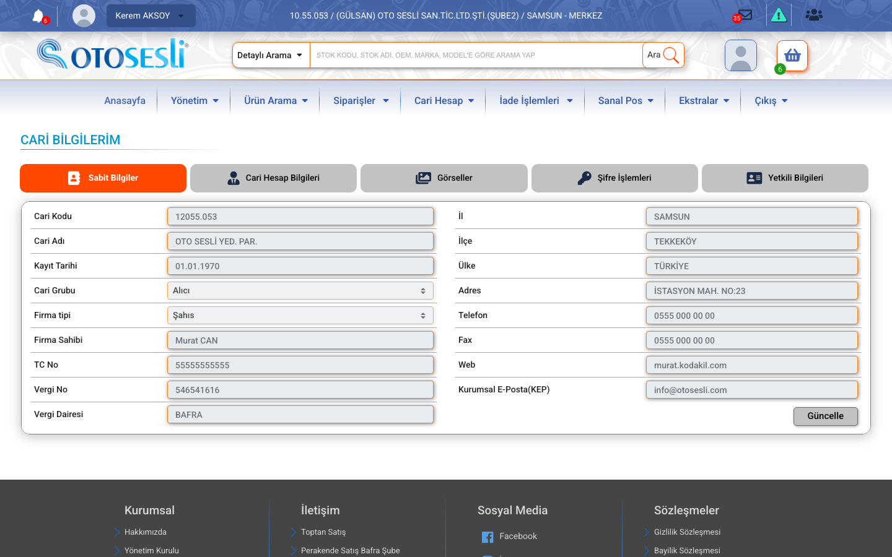
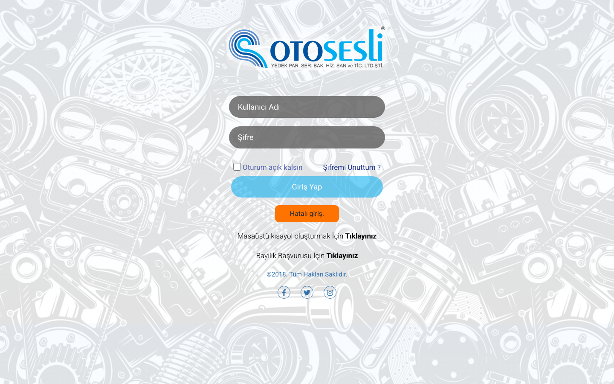
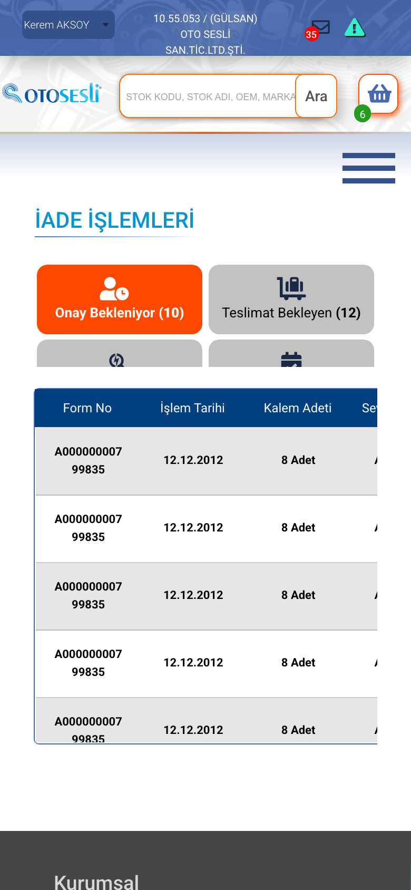

# Oto Sesli B2B — Dealer Portal UI

**The complete front end of an ERP-backed B2B portal for an automotive spare-parts distributor:** about 90 screens for dealers, sales reps and back-office staff, covering catalogue and stock, orders and warehouse dispatch, returns, current accounts, finance reports and virtual POS.




| | |
|---|---|
| **Role** | UI design and front-end development of every template |
| **Client** | Oto Sesli: automotive spare-parts wholesale and retail (Otoparcasan / Otosesli) |
| **Period** | 2020 |
| **Scope** | 93 PHP templates, one shared shell, mock data shaped like the ERP exports |
| **Stack** | HTML · CSS · Bootstrap 4.1 · Materialize 1.0 · jQuery 3.3 / jQuery UI · Chart.js 2.7 · FullCalendar · Card.js · basictable |

## What it is

A self-service portal that puts **stock, dealer-specific pricing, order status, returns and account statements** in front of every dealer, and gives sales reps and managers their own reporting views. This repository is the UI layer: the templates carry sample data shaped like the ERP records, and the server-side data binding is not part of this archive.

## Highlights

- **Dense, scannable product rows.** Six stock states shown as icons, OEM cross-reference codes, campaign / new / opportunity badges, quantity input and add-to-cart in one row. Grid and list views, plus "smart sort".
- **Price breakdown on hover.** Gross price → general discount → dealer discount → net → VAT → recommended retail price, so dealers can see their margin without leaving the list.
- **Status-tab pattern everywhere work moves through stages.** Orders (awaiting approval → awaiting dispatch → preparing → ready → to invoice), returns, daily operations and approvals all share one tab component with live counters.
- **Warehouse dispatch board.** A full-screen view of dispatch orders by state, with counters per stage and a refresh control.
- **Finance views.** A 12-month cash-flow matrix (receivables, cheques, bank, cash, payables, net position) with Excel export, account ageing, reconciliation, invoice profitability and purchase reports.
- **Sales team dashboards.** Sales and collection targets per rep with Chart.js bar charts, commission (prim) management and virtual-POS usage per rep.
- **Responsive tables.** Wide ERP tables collapse into stacked cards on phones (basictable).

## Screen map

| Area | Screens | Examples |
|---|---:|---|
| Catalogue & stock | 13 | product search, supplier search, new arrivals, stock received, campaign products, product analysis, Q&A |
| Orders & warehouse | 13 | 3-step order flow, order list and detail, **warehouse dispatch**, **goods receipt**, invoiced orders |
| Finance & reporting | 13 | **cash flow**, receivables and payables, income table, invoice profitability, purchasing, daily statistics, POS report |
| Operations & admin | 14 | workflow approvals, quality management, payroll, fixed assets, product and news management, settings |
| Current accounts | 12 | account search and profile, statement, terms, ageing, reconciliation, risk, balances |
| Sales team | 7 | rep commission, sales and collection targets and charts |
| Returns | 6 | return cart, detail, status, tracking, confirmation |
| Virtual POS & banking | 6 | POS management, installment rates, POS analytics, payment plans, bank accounts |
| Sign-in & session | 5 | dealer login, lock screen, password reset, user management |

A progress tracker used with the backend team during the build is kept in [`portal/b2btablo.html`](portal/b2btablo.html).

## Screenshots

| | |
|---|---|
|  **Product search** with stock states, OEM codes and the price breakdown popover |  **Order flow:** cart → totals → send |
|  **Cash-flow matrix,** 12 months, Excel export |  **Sales & collection report** by sales rep |
|  **Returns workflow** with status tabs |  **Daily operations:** invoices, collections, profitability, visits |
|  **Current account profile** |  **Dealer sign-in** |

<p align="center"></p>

## Running it

The templates only use PHP for `include`, written with short open tags:

```bash
cd portal
php -d short_open_tag=On -S localhost:8081
# open http://localhost:8081/productsearch.php
```

## Repository layout

```
portal/
├── header.php, footer.php     shared shell: account context bar, detailed search, mega menu, footer
├── *.php                      89 screens (see the screen map)
├── b2btablo.html              build progress tracker
├── css/                       style.css (all screens), per-screen styles, vendor CSS
├── js/                        main.js, Chart.js setup, FullCalendar, Card.js, jsPDF, basictable
└── images/                    icons, bank logos, product imagery
docs/screenshots/
```

## What I would do differently today

- Build the repeated pieces (status tabs, data table with totals row, product row, price popover, filter bar) as **typed React components with Storybook**, instead of copying markup between 90 templates.
- Split the 11,000-line stylesheet into **design tokens and component styles**.
- Use a **data-grid component** with server-side paging, sticky headers and column settings for the ERP tables.
- Make **keyboard and screen-reader support** part of the components from the start, especially for the hover-only popovers.

---

<sub>Front-end templates built for Oto Sesli. People and dealer names in the sample data and screenshots are fictional, and photos have been replaced with placeholders. Shared for portfolio purposes; no license is granted for reuse.</sub>
